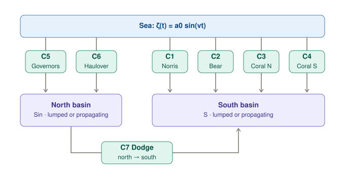
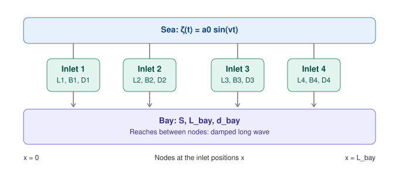
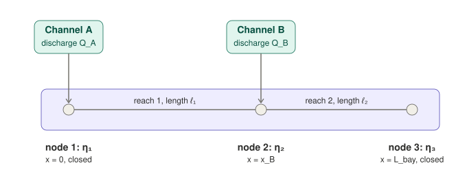
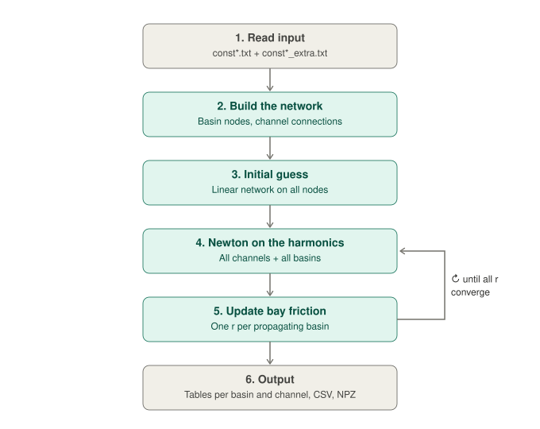
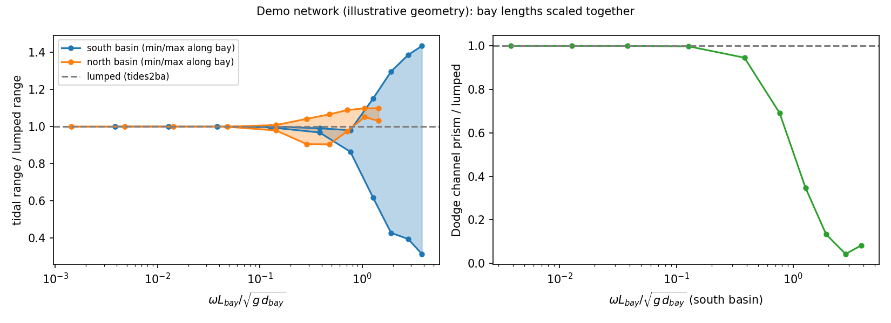

# multi-basin-tides-fourier

A reduced-complexity model for tides in **networks of semi-enclosed basins**: M basins connected to each other and to the open sea by N channels, with arbitrary topology. The periodic tidal response is computed by **harmonic balance** (Fourier series + Newton). Each basin is either **lumped** (a single water level) or **propagating** (a 1D bay in which the tide travels and decays).

The code generalises the lumped time-stepping programs `tides4bo` (one basin, four inlets) and `tides2ba` (two basins, seven channels). It reads their parameter files unchanged, and in the **small-bay limit it reproduces their results** (see [Validation](#validation)).

<p align="center"></p>

---

## Contents

- [What it does](#what-it-does)
- [Model](#model)
- [Numerical method](#numerical-method)
- [Installation](#installation)
- [Usage](#usage)
- [Input files](#input-files)
- [Output](#output)
- [Validation](#validation)
- [Lumped or propagating?](#lumped-or-propagating)
- [Limitations](#limitations)
- [Repository layout](#repository-layout)
- [Reference](#reference)
- [How to cite](#how-to-cite)
- [License](#license)

---

## What it does

Given the geometry of the channels and basins and the tide at the sea, the program returns the periodic (steady-state) solution:

- **In every basin:** tidal range, maximum, minimum, mean level and phase lag at each node and at user-defined stations along the bay.
- **In every channel:** discharge and velocity time series, amplitude and phase of the first harmonic, tidal prism in both directions, and residual (mean) discharge.
- **For every basin:** how the flood prism is shared among the channels connected to it.

Compared with the original time-stepping programs:

| | `tides4bo` / `tides2ba` | `multi_basin_fourier.py` |
|---|---|---|
| Channel equations | inertia + quadratic friction | identical |
| Basins | one level each | one level **or** 1D propagating bay |
| Topology | hard-coded | read from a text file, any M and N |
| Solution method | explicit Euler from rest | harmonic balance + Newton |
| Transient, `dt`, `nt`, `n` | yes | none: only the number of harmonics K |
| Open boundaries | one sea | one or more seas, with own amplitude and phase |
| Small-bay limit | — | coincides with the lumped programs |

## Model

### Channels

Channel $j$ connects end $a$ to end $b$. Each end is either a sea or a point $x$ of a basin, and $u_j>0$ means flow from $a$ to $b$. The momentum equation is the same as in `tides4bo`/`tides2ba`:

$$
\frac{L_j}{g}\frac{du_j}{dt} + R_j\,u_j|u_j| = \eta_a(t) - \eta_b(t),
\qquad
R_j = \frac{L_j}{k_{s,j}^2\,D_j^{4/3}} + \frac{m_j}{2g}
$$

The first friction term is Manning–Strickler, and it matches the original programs, where $C = k_s D^{1/6}/\sqrt{g}$. The second is an optional entrance/exit loss $m_j$. The discharge is $Q_j = B_j D_j u_j$.

### Basins

Every quantity is written as a Fourier series, $x(t) = \mathrm{Re}\sum_k X_k\, e^{ik\omega t}$. Each basin turns the discharges entering its nodes into levels at those nodes.

**Lumped basin.** A single level, with the same continuity equation as the original programs:

$$ ik\omega\, S\, \eta_k = \sum_{\text{channels}} Q_k $$

**Propagating basin.** A prismatic 1D bay of surface $S$, length $L_{bay}$, width $B = S/L_{bay}$ and depth $d$, closed at both ends. Inside it the linearised long-wave equations hold:

$$
B\,\partial_t\eta + \partial_x Q = 0, \qquad \partial_t Q + g d B\,\partial_x\eta + rQ = 0
$$

For harmonic $k$ they reduce to $\eta'' + \kappa_k^2\eta = 0$, with the complex wavenumber

$$
\kappa_k^2 = \frac{(k\omega)^2}{g d}\left(1 - \frac{i\, r_k}{k\omega}\right)
$$

$\mathrm{Re}\,\kappa$ sets the wavelength and $\mathrm{Im}\,\kappa$ the damping. The equations are **solved analytically, not on a grid**.

<p align="center"></p>

The bay is split into **reaches** between **nodes**. Nodes sit at both ends, at every channel opening and at the river inlet. No water enters a reach between its end nodes, so the exact solution in a reach of length $\ell$ is

$$
\eta(s) = \frac{\eta_a \sin\kappa(\ell-s) + \eta_b \sin\kappa s}{\sin\kappa\ell}
$$

It gives the discharge leaving each end node into the reach, which is an exact two-port relation, like a transmission line:

$$
Q_{a\to\text{reach}} = Y_0\left[\frac{\eta_b}{\sin\kappa\ell} - \frac{\eta_a}{\tan\kappa\ell}\right],
\qquad
Y_0 = \frac{ik\omega B}{\kappa}
$$

<p align="center"></p>

Mass balance at each node, (discharge from channels) = (discharge into adjacent reaches), gives a linear system $\mathbf{Y}(k\omega)\,\boldsymbol\eta_k = \mathbf{Q}_k$. $\mathbf{Y}$ is assembled like the admittance matrix of an electrical network. For the example in the figure:

```
| −Y₀c₁        Y₀s₁          0     |   | η₁ |   | Q_A |
|  Y₀s₁   −Y₀c₁ − Y₀c₂     Y₀s₂    | · | η₂ | = | Q_B |        c_i = cot κℓ_i ,  s_i = csc κℓ_i
|   0          Y₀s₂        −Y₀c₂   |   | η₃ |   |  0  |
```

Closed ends need no special treatment. Once the node levels are known, the formula above gives $\eta$ anywhere in the bay; this is how the output stations are computed.

### The lumped limit

For $\kappa\ell \to 0$, $\cot z \approx 1/z - z/3$ and $\csc z \approx 1/z + z/6$:

- the $1/z$ terms act as very large conductances, $gdB/[(ik\omega + r)\ell]$, which force all nodes of a basin to the same level;
- the $O(z)$ terms give each node half the storage of its adjacent reaches, $ik\omega B\ell/2$.

Summing the node equations leaves $ik\omega S\eta = \sum Q$, which is **exactly the lumped basin**, whatever the positions of the channel openings. The relevant parameter is

$$ \varepsilon = \frac{\omega L_{bay}}{\sqrt{g\, d_{bay}}} $$

For $\varepsilon \ll 1$ a propagating basin and a lumped basin give the same answer. The program prints $\varepsilon$ for every propagating basin.

### Mean flow and bay friction

- **Mean ($k=0$).** A reach has no storage and acts as a resistance, $Q = gdB(\eta_a-\eta_b)/(r_0\ell)$. This allows mean set-up, river-driven slopes (`Q_river`) and residual circulation through the network.
- **Bay friction.** $r$ is linearised with an **energy-consistent Lorentz** closure on the dominant harmonic, $r_1 = \frac{8}{3\pi}\frac{g}{k_s^2 d^{4/3}}\frac{\langle|u_1|^3\rangle}{\langle|u_1|^2\rangle}$, averaged along the bay. The mean flow and overtides use $r_k = 1.5\,r_1$, the ratio $4/\pi$ over $8/3\pi$. $r_1$ depends on the solution and is iterated to convergence.

## Numerical method

<p align="center"></p>

1. **Read input.** The parameter file of the tides program plus an extra file with the topology.
2. **Build the network.** Nodes of every basin, and a channel–node incidence (+1 into a node, −1 out of it).
3. **Initial guess.** Channel friction is Lorentz-linearised, and the whole network becomes one linear system over all nodes of all basins, solved per harmonic.
4. **Newton on the harmonics.** The unknowns are the Fourier coefficients of every channel velocity (mean + K harmonics) and the mean level of every basin. In each residual evaluation the program:
   - synthesises $u(t)$ and computes the true $u|u|$ in time, projecting it back with the FFT (pseudo-spectral);
   - sums channel discharges at the basin nodes;
   - obtains node levels from each basin's admittance;
   - evaluates the channel momentum equations and the mean mass balance of each basin.

   `scipy.optimize.root` drives the residual to about $10^{-14}$.
5. **Bay friction.** Every propagating basin updates its $r$, and steps 4–5 repeat until all $r$ converge, typically in 10–15 iterations. This step is skipped when all basins are lumped.
6. **Output.**

## Installation

```bash
git clone https://github.com/enricomoresco/multi-basin-tides-fourier.git
cd multi-basin-tides-fourier
pip install -r requirements.txt      # numpy, scipy, matplotlib
```

## Usage

```bash
# parameter file of the tides program + extra file
python multi_basin_fourier.py examples/two_basins_7channels/const2ba.txt examples/two_basins_7channels/const2ba_extra.txt

# a folder containing const*.txt and const*_extra.txt
python multi_basin_fourier.py examples/two_basins_7channels

# compare with an independent time integration of the same equations
python multi_basin_fourier.py examples/two_basins_propagating_demo --check
```

| Option | Meaning |
|---|---|
| `--check` | Integrates the same equations in time (RK45; propagating basins on a finite-volume grid) and reports the differences |
| `--no-plot` | Skip the matplotlib figure |
| `--out PREFIX` | Prefix of the output files (default: `<const file>_fourier`) |

## Input files

### 1. Parameter file (unchanged from the tides programs)

Section `[physical_variables]`:

| Key | Meaning |
|---|---|
| `L1, D1, B1, L2, …` | channel length, depth and width [m]; channels are counted until one is missing |
| `kse` or `kse1, kse2, …` | Strickler coefficient [m^(1/3)/s], global or per channel |
| `a0`, `nu` | tidal amplitude [m] and angular frequency [1/s] |
| `g` | gravity [m/s²] |
| `S`, `Sin`, … | basin surfaces [m²], referenced by name from the extra file |

Not used: initial conditions (`U10`, `h20`, …) and time-stepping parameters (`nt`, `n`, `ac`, `deltat`). The solution is periodic, so it needs neither.

### 2. Extra file (topology and additional parameters)

```ini
[basin:south]
surface = S                # key of the parameter file, or a number [m2]
type = propagating         # lumped | propagating
L_bay = 40000              # propagating only: length along the axis [m]
d_bay = 2                  # propagating only: mean depth [m]
x_obs = 0, 20000, 40000    # optional output stations [m]
Q_river = 0                # optional freshwater discharge [m3/s]

[basin:north]
surface = Sin
type = lumped

[channels]
names = Norris, Bear, CoralBanksN, CoralBanksS, Governors, Haulover, Dodge
c1 = sea -> south@2000     # <from> -> <to>; basin@x = opening position along a propagating basin
c2 = sea -> south@6000
c3 = sea -> south@25000
c4 = sea -> south@35000
c5 = sea -> north          # @x is ignored for lumped basins
c6 = sea -> north
c7 = north -> south@0      # basin-to-basin channel
m_loss = 0                 # one value, or one per channel

[forcing]
phase_deg = 90             # 90 reproduces a0*sin(nu t) of the tides programs

[numerics]
K = 30                     # harmonics
M = 2048                   # samples per period (M > 4K)
```

Optional keys:

| Section | Key | Default | Meaning |
|---|---|---|---|
| `[basin:*]` | `kse_bay` | `kse` | bay Strickler coefficient |
| | `minor_factor` | 1.5 | bay friction on the mean flow and overtides, relative to the dominant harmonic |
| | `r_bay` | iterated | fixed linear bay friction [1/s] |
| | `x_river` | `L_bay` | where `Q_river` enters |
| `[channels]` | `kseJ` | parameter file | override the Strickler coefficient of channel J |
| `[forcing]` | `amp_k`, `phase_k_deg` | 0 | overtides at k·ω |
| | `amplitude`, `omega`, `mean` | `a0`, `nu`, 0 | override the parameter file |
| `[sea:<name>]` | `amplitude`, `phase_deg`, `amp_k`, … | | additional open boundary, used as `c9 = <name> -> north` |

A basin may be lumped while another is propagating, and propagating basins can have any number of channel openings.

## Output

- **Terminal report.** Per basin: range, max, min, mean level and lag at every node and station, plus the flood-prism share of each connected channel. Per channel: $|Q_1|$, phase, $u_{max}$, prism in both directions and mean discharge.
- **`<prefix>_timeseries.csv`.** One tidal period: sea levels, basin levels at every node, channel discharges.
- **`<prefix>_harmonics.npz`.** Fourier coefficients of channel velocities and node levels, node positions and channel areas.
- **`<prefix>.png`.** Levels and discharges over one period.

## Validation

`python tests/validate_against_tides.py` runs the checks below; it takes about a minute.

**1. Lumped solution vs the original time-stepping programs.** The main loop of `tides4bo` and `tides2ba` is replicated with the same explicit Euler scheme and parameter files (last-cycle tidal range, m):

| Case | Basin | Fourier | Euler `nt=500` | Euler `nt=5000` |
|---|---|---|---|---|
| `one_basin_4inlets` (tides4bo) | bay | 0.3143 | 0.3146 | 0.3143 |
| `two_basins_7channels` (tides2ba) | south | 0.5457 | 0.5463 | 0.5458 |
| `two_basins_7channels` (tides2ba) | north | 0.7203 | 0.7205 | 0.7203 |

The remaining differences shrink with the Euler time step.

**2. Small-bay limit.** The propagating demo network, shrunk 1000×, gives the same ranges as the lumped network to within about $10^{-7}$ (relative), at every point of both bays.

**3. Propagating basins vs time integration.** `--check` on `two_basins_propagating_demo` ($\varepsilon \approx 1.3$ south, $0.5$ north) gives maximum differences of 0.9% on channel discharges and 1.1 mm on levels with 200 cells per basin. With 400 cells these drop to 0.3% and 0.6 mm, so the residual difference is the grid error of the reference model.

**4. Transition from lumped to propagating.** With the demo network and all bay lengths scaled together, the lumped solution is recovered for $\varepsilon \lesssim 0.1$, and propagation matters increasingly above $\varepsilon \sim 0.3$:

<p align="center"></p>

## Lumped or propagating?

- **$\varepsilon \lesssim 0.1$–0.2:** lumping changes ranges and prism shares by well under 1%. Use `lumped`.
- **$\varepsilon \gtrsim 0.3$:** use `propagating` and provide `L_bay`, `d_bay` and the opening positions.
- **In doubt:** run the basin as `propagating` and read $\varepsilon$ in the report.

If all channels open at the same point of a basin, propagation changes the basin response but hardly the flow partition among those channels. The partition changes when openings are at different positions.

Channels opening very close to each other are handled correctly. The solution tends continuously to the shared-node case, and openings closer than $10^{-6}L_{bay}$ are merged into one node.

## Limitations

- **Basin geometry:** propagating basins are prismatic 1D bays. Two-dimensional or branched basins can be represented as several basins linked by short, wide channels.
- **Bay friction:** linearised; channel friction is fully nonlinear.
- **Fixed geometry:** channel cross-sections and bay depth do not vary with the water level; no wetting and drying.
- **Laterally averaged bays:** local 2D effects near close channel openings (jets, recirculation) are not represented; `m_loss` can absorb part of them.
- **Truncation:** channels dominated by friction generate many harmonics. Check convergence by increasing K.

## Repository layout

```
multi_basin_fourier.py              model, solver, report, time-domain check
requirements.txt
LICENSE                             MIT License
CITATION.cff                        citation metadata (also read by Zenodo)
examples/
  one_basin_4inlets/                const4bo.txt (+ extra): tides4bo configuration
  two_basins_7channels/             const2ba.txt (+ extra): tides2ba configuration
  two_basins_propagating_demo/      same network with propagating basins
                                    (ILLUSTRATIVE geometry: replace L_bay, d_bay, positions)
tests/
  validate_against_tides.py         checks against tides4bo/tides2ba and the small-bay limit
docs/figures/                       schematics used in this README
```

## Reference

The lumped time-domain model generalised here was used in:

> Moresco, E., De Leo, F., Talke, S. A., Tambroni, N. (2026). *Historical changes in tides and storm-surge propagation in Biscayne Bay: A reduced-complexity modeling study.* Estuarine, Coastal and Shelf Science, 341, 110116. https://doi.org/10.1016/j.ecss.2026.110116

## How to cite

If you use this code, please cite it through the metadata in [`CITATION.cff`](CITATION.cff) (GitHub shows them under *Cite this repository*). Each release is archived on Zenodo with a permanent DOI.

## License

Released under the MIT License: see [`LICENSE`](LICENSE).
